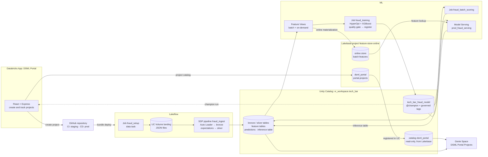

# DSML Portal: PIX fraud detection on Databricks

An end-to-end build on Databricks for a Brazilian bank that needs to detect fraud in PIX transactions. A Databricks App, the **DSML Portal**, creates and tracks ML projects from a Project Template. The project created here ingests raw PIX transactions, governs them in Unity Catalog, trains and serves a fraud model with features served from Lakebase, and makes the projects queryable in natural language through a Genie Space.

## Business problem

PIX is the Brazilian instant payment system: transfers settle in seconds, 24/7, and cannot be reversed. Fraud (account takeover, social engineering, mule accounts) has to be caught before the transfer settles, so the bank needs a fraud score at request time, built on governed data and on features consistent between training and serving.

At the same time, the data science platform team of the bank needs each new ML use case to start from a standard project: a repository with a tested bundle, CI/CD to staging and prod, a registered model with an approval alias, and tags for governance. The DSML Portal gives data scientists a self-service form for that, and gives the business one place to follow the projects, their models and their runs.

The data is synthetic: about 1M PIX transactions from 10,000 account holders over 45 days, and 100,000 labeled transactions with about 5% fraud.

## Architecture



The flow is integrated across the six stages:

1. The **Databricks App** creates the project: a public GitHub repository with the bundle rendered from the `Classification` template, and a row in `portal.projects` (**Lakebase**).
2. The pull request `init` → `main` runs the CI (deploy and training in staging); the merge runs the CD (deploy to prod).
3. In prod, **Lakeflow** generates the raw files into a UC Volume and the SDP pipeline loads them with Auto Loader into bronze streaming tables and silver materialized views with expectations.
4. **Unity Catalog** governs the volume, the tables, the model (alias `champion`) and the governed tags `team` and `confidentiality`.
5. **ML**: batch Feature Views (offline Delta, online Lakebase) and on-demand features feed the training job; the champion model scores in batch and online through a route-optimized endpoint that looks up the features in Lakebase and logs every request to an inference table.
6. The **Genie Agent** answers questions about the projects over the Lakebase catalog registered in Unity Catalog, the prod tables and the MLflow and Jobs system tables. The portal shows the production run of each project.

## Stage map

| Stage | Component | Artifact |
|---|---|---|
| Lakeflow | Lakeflow Spark Declarative Pipelines with Auto Loader from a UC Volume, orchestrated by Lakeflow Jobs | [`ingest.py`](app-dsml-portal/templates/classification/template/setup/pipelines/ingest.py), [`ingest-pipeline-resource.yml`](app-dsml-portal/templates/classification/template/resources/ingest-pipeline-resource.yml), [`setup-workflow-resource.yml`](app-dsml-portal/templates/classification/template/resources/setup-workflow-resource.yml), [`data.py`](app-dsml-portal/templates/classification/template/setup/notebooks/data.py); pipeline `prod_fraud_ingest`, job `prod_fraud_setup` |
| Unity Catalog | Volume `landing`, bronze and silver tables, feature tables, model `tech_bar_fraud_model` with alias `champion`, governed tags, Lakebase catalog `dsml_portal` | [`tag_policy.py`](app-dsml-portal/templates/classification/template/setup/notebooks/tag_policy.py), [`register.py`](app-dsml-portal/templates/classification/template/training/notebooks/register.py), [`ml-artifacts-resource.yml.tmpl`](app-dsml-portal/templates/classification/template/resources/ml-artifacts-resource.yml.tmpl), [`portal_genie.py`](app-dsml-portal/genie/portal_genie.py) |
| Lakebase | Lakebase project `feature-store-online`: database `dsml_portal` (table `portal.projects`, the portal catalog) and the online feature store | [`create_database.sh`](app-dsml-portal/scripts/create_database.sh), [`dsml_portal.app.yml`](app-dsml-portal/resources/dsml_portal.app.yml), [`online_store.py`](app-dsml-portal/templates/classification/template/setup/notebooks/online_store.py) |
| ML | Feature Views (batch and on-demand), HyperOpt + XGBoost training with a quality gate, UC registration, batch scoring, route-optimized Model Serving with an inference table | [`training/notebooks/`](app-dsml-portal/templates/classification/template/training/notebooks/), [`batch_scoring.py`](app-dsml-portal/templates/classification/template/scoring/notebooks/batch_scoring.py), [`online_deploy.py`](app-dsml-portal/templates/classification/template/serving/notebooks/online_deploy.py), [CI/CD workflows](app-dsml-portal/templates/classification/template/.github/workflows/) |
| Genie Agent | Genie Space `DSML Portal Projects`, created by the job `dsml_portal_genie` | [`portal_genie.py`](app-dsml-portal/genie/portal_genie.py), [`dsml_portal_genie.job.yml`](app-dsml-portal/resources/dsml_portal_genie.job.yml) |
| Databricks App | DSML Portal (React + Express, user authorization), deployed with a bundle | [`app/`](app-dsml-portal/app/), [`databricks.yml`](app-dsml-portal/databricks.yml), [`grant_user_scopes.sh`](app-dsml-portal/scripts/grant_user_scopes.sh), [`templates/classification/`](app-dsml-portal/templates/classification/) |

## Repository layout

```
./
├── README.md                     # this file
├── app-dsml-portal/              # DSML Portal: app, bundle, Genie job and Project Template
│   ├── databricks.yml            # bundle `dsml_portal` (target `dev`)
│   ├── README.md                 # portal guide: deploy, Genie Space, usage, template parameters
│   ├── app/                      # app source (client: React + Vite, server: Express)
│   ├── resources/                # app `dsml-portal` and job `dsml_portal_genie`
│   ├── genie/portal_genie.py     # Lakebase catalog in UC + Genie Space
│   ├── scripts/                  # catalog database and user scopes
│   └── templates/classification/ # Project Template (fraud bundle: setup, training, scoring, serving, CI/CD)
├── evidence/                     # execution evidence, as text
└── obsidian/                     # project notes
```

The project generated by the portal in this run is public: https://github.com/vorodrigues/databricks-tech-bar-fraud-project.

## How to reproduce

Environment of this run: workspace `vr-workspace` (`https://dbc-963f3995-3da2.cloud.databricks.com`), Serverless compute, catalog `vr_workspace` with the schemas `tech_bar_dev`, `tech_bar_staging` and `tech_bar` (prod), workspace root `/Workspace/Users/victor.rodrigues@databricks.com/tech_bar`.

1. **Prerequisites** (details in [`app-dsml-portal/README.md`](app-dsml-portal/README.md#prerequisites)): Databricks CLI profiles `vr-workspace` and `admin-account` (account admin), `gh` signed in to the GitHub account that owns the project repositories, the service principal `cicd-ml-serving`, the group `ml-viewers`, the secret scopes `dsml-portal` (`github-token`) and `mlops` (`sp-client-id`, `sp-client-secret`), the Lakebase project `feature-store-online`, and the three schemas.
2. **Deploy the portal** from `app-dsml-portal/`:
   ```bash
   bash scripts/create_database.sh
   (cd app && npm ci && npm run build)
   databricks -p vr-workspace bundle deploy
   databricks -p vr-workspace bundle run dsml_portal
   bash scripts/grant_user_scopes.sh
   ```
3. **Grant the service principal** `cicd-ml-serving` what the staging and prod targets need: `workspace-access`, `CAN_MANAGE` on the workspace root, `USE CATALOG` on `vr_workspace`, on `tech_bar_staging` and `tech_bar` the schema privileges to read and create tables, volumes, models, functions, materialized views and features, `CAN_USE` on the Lakebase project, and the tag policy manager role on `team` and `confidentiality`.
4. **Create the project** in the portal (`Create new project`): name `databricks-tech-bar-fraud-project`, public repository, template `Classification`, model `tech_bar_fraud_model`, experiment `tech_bar_fraud_experiment`, catalog `vr_workspace`, online store `feature-store-online`, service principal `cicd-ml-serving`, group `ml-viewers`. The staging and prod root paths of this run are `<workspace root>/databricks-tech-bar-fraud-project/<target>` (set in `databricks.yml` on the `init` branch).
5. **Promote**: open the pull request `init` → `main`. The CI (`CI - staging`) validates, deploys and trains in staging. The staging tables come from `staging_fraud_setup`, which has to run once after the first staging deploy (`databricks -p vr-workspace jobs run-now <job_id>`) before the CI training succeeds; then re-run the CI.
6. **Approve** the pull request in the portal (`Details`). The merge triggers the CD (`CD - prod`), which deploys the bundle to prod.
7. **Run prod**, in order: `prod_fraud_setup`, `prod_fraud_training`, `prod_fraud_batch_scoring`, `prod_fraud_online_deploy` (`databricks -p vr-workspace jobs run-now <job_id>`). Then query the endpoint as in [`evidence/serving/query.md`](evidence/serving/query.md).
8. **Genie**: from `app-dsml-portal/`, run `databricks -p vr-workspace bundle run dsml_portal_genie`, then ask the sample questions in the Space `DSML Portal Projects` (Genie UI or Conversation API).

## Evidence

The [`evidence/`](evidence/) folder holds the proof of execution as text. Its [index](evidence/README.md) maps every file to a stage.

| Stage | Evidence |
|---|---|
| Lakeflow | [`pipeline/`](evidence/pipeline/): completed update, row counts per table, expectation metrics; [`jobs/runs.md`](evidence/jobs/runs.md): state and duration of every prod run and task |
| Unity Catalog | [`unity-catalog/`](evidence/unity-catalog/): prod tables and volume, model version with alias `champion` and tags, governed tag policies |
| Lakebase | [`lakebase/`](evidence/lakebase/): query of `dsml_portal.portal.projects`, online store and online feature table |
| ML | [`jobs/`](evidence/jobs/): notebooks of every prod task with their outputs; [`ml/`](evidence/ml/): training run and batch predictions; [`serving/`](evidence/serving/): real request and response; [`cicd/`](evidence/cicd/): CI and CD logs |
| Genie Agent | [`genie/`](evidence/genie/): Space definition and, for each sample question, the generated SQL and the result |
| Databricks App | [`databricks-app/`](evidence/databricks-app/): app state, deployments, logs and portal API responses; [`project-repo/`](evidence/project-repo/): generated repository and merged pull request |

Key results of the run: 1,000,000 transactions and 100,000 labels ingested with 0 rows dropped by the expectations; `test_auc` 0.696 on the synthetic data; 100,000 transactions scored in batch; a real request to `prod_fraud_serving` answered with HTTP 200; the five Genie sample questions answered with SQL over the expected tables.

## Known limitations

- The endpoint and the batch scoring return the predicted class (`1` = fraud), not a probability.
- `system.mlflow.runs_latest` can lag a few minutes behind MLflow, so a training run that just finished may take a while to appear in Genie answers.
- The Lakebase project is an autoscaling project, read through the Postgres API (`postgres` app resource); the portal lists it as an online store next to the Feature Engineering online stores.
- `ml-viewers` is a workspace-local group, so Unity Catalog grants for Genie readers go to users or account groups.
- The portal suggests the staging and prod root paths `/Workspace/<project>/<target>`; edit them in `databricks.yml` of the project to place it elsewhere.
